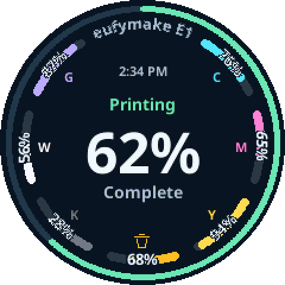

# EufyMake E1 Monitor 1.3.3

This release adds an optional ESPHome companion display for the round 240 × 240 touchscreen. It shows printer status and progress, six ink levels, color-coded waste fill and cartridge expiration information. The screen dims automatically after ten minutes of printer idle.

- [Round display setup guide, hardware link and screen examples](https://github.com/deadmeat75/eufymake-e1/blob/v1.3.3/esphome/README.md)
- [Copyable ESPHome configuration](https://github.com/deadmeat75/eufymake-e1/blob/v1.3.3/esphome/eufymake-round.example.yaml)

Update the integration through HACS. Install the optional display from ESPHome Device Builder. Future display firmware updates can be installed wirelessly through ESPHome.

