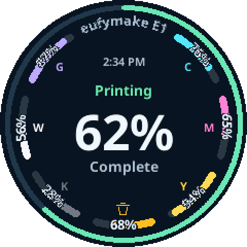
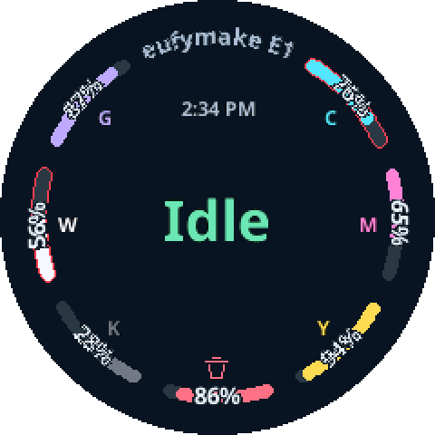
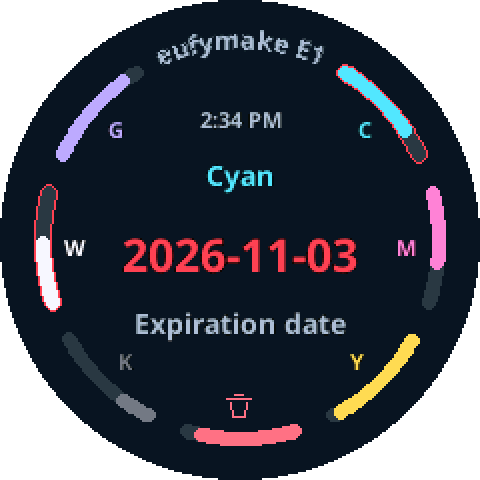
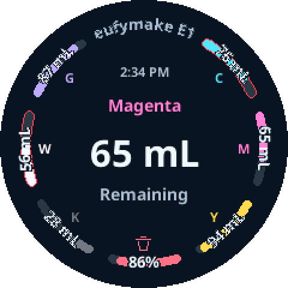

# Round display for eufyMake E1

The optional ESPHome display puts printer status, a clock, print or maintenance progress, and ink and waste levels on a 240 × 240 touchscreen. It reads the same Home Assistant entities as the E1 Monitor dashboard over Wi-Fi.

## Screen examples

Rendered from the firmware drawing code with sample Home Assistant readings. The images show the display area.

| Printing | Idle with expired ink |
| --- | --- |
|  |  |
| **Selected cyan expiration date** | **Selected magenta volume** |
|  |  |

## Hardware

The tested unit uses an ESP32-S3 with 16 MB flash, a 240 × 240 GC9A01A display and a CST816-family touchscreen. The firmware uses the GPIO wiring in the package. Check the variant before buying or flashing, since similar-looking displays can use different controllers or wiring. [AliExpress listing for the tested unit](https://www.aliexpress.com/item/3256808830214744.html?spm=a2g0o.order_list.order_list_main.85.52101802PuE7SV)

## Install

1. Install or update **EufyMake E1 Monitor** through HACS, restart Home Assistant, and confirm that the printer sensors appear.
2. In Home Assistant, find the E1's **Printer status** sensor and copy its entity ID. Remove the trailing `_printer_status` to get the prefix, including `sensor.`. If you renamed individual sensors or Home Assistant added suffixes, use the entity override substitutions from [the package](eufymake-round.yaml).
3. In ESPHome Device Builder, create a configuration using [eufymake-round.example.yaml](eufymake-round.example.yaml). Set `printer_prefix` and your IANA time zone. Add the four referenced secrets to your local ESPHome `secrets.yaml`. Use your 2.4 GHz Wi-Fi credentials, a unique OTA password and a base64-encoded 32-byte native API key. The ESPHome new-device wizard can generate the key.
4. Validate the configuration. For the first ESPHome install on a unit running its original firmware, connect it by USB and install using ESPHome's wired installation option. Use a USB data cable. If the serial port does not appear, hold the button while connecting USB to enter the ESP32-S3 bootloader, then release it. For a display already running ESPHome, use wireless installation with its existing OTA credentials.
5. In Home Assistant, open **Settings → Devices & services** and configure the discovered ESPHome device. If discovery is unavailable, add the **ESPHome** integration using the display's hostname or IP address and the native API key.

For another display, give the new ESPHome node a distinct name and use the corresponding printer prefix.

## Controls

- Press the physical button once to cycle **percent → estimated mL → number only → expiration dates**. In date mode, the arc numbers disappear. Tap an arc to see its date in the center when one is available. Estimated mL assumes a 100 mL cartridge. Waste is displayed as fill, with no mL estimate.
- Double-press to rotate the display 180°. Touch follows the orientation.
- Tap an arc to see its reading in large type. Tap the center or wait eight seconds to return to printer status. Active job progress keeps its percentage format across button modes.
- Red arc outlines mark expired inks. Waste is green below 60% full, amber at 60–79%, and pink-red at 80% and above.
- After ten minutes of printer idle, the backlight dims to 30%. A status or supply change, touch, or button press wakes it.

## Updates

Use HACS for integration releases. When Home Assistant reports a new status label through the existing sensor, the display can show it over Wi-Fi. For changes to the display layout or controls, update the package's pinned release ref to a compatible tag and select **Install → Wirelessly** in ESPHome Device Builder. Keep the same node name and credentials when updating.
